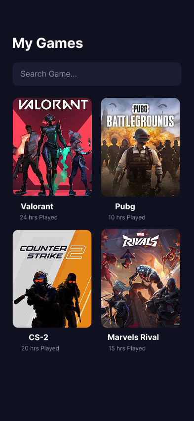
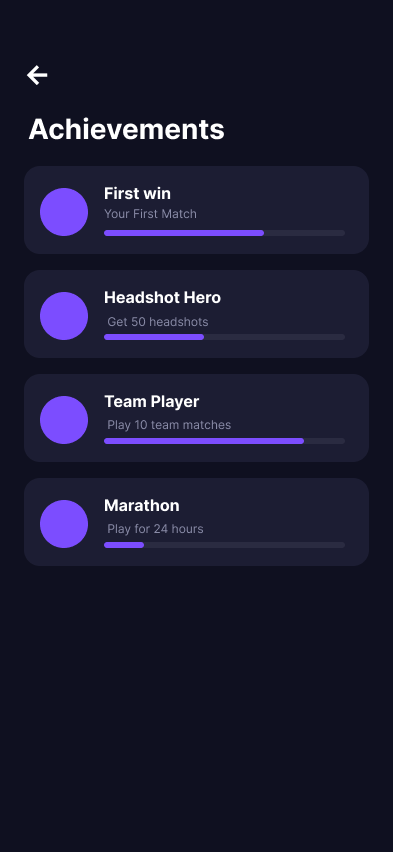
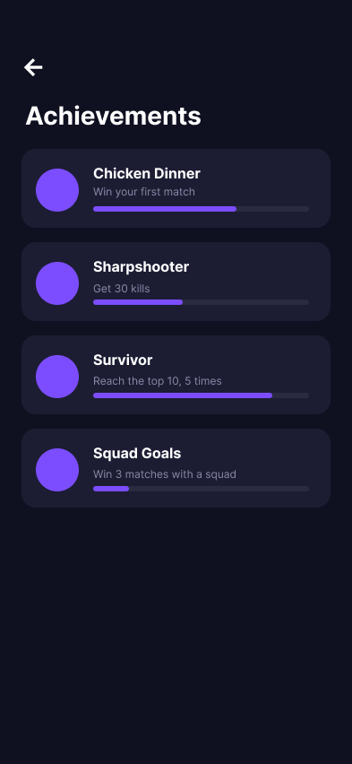
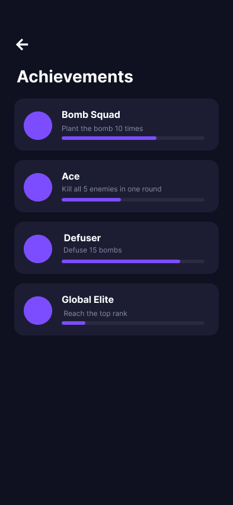
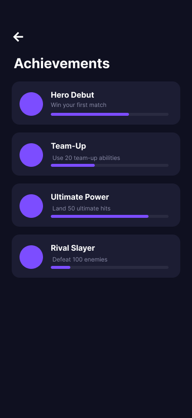

# game-library-app-ui.
# Game Library App UI

A dark-themed mobile app design for browsing games, viewing game details, and tracking achievements. Designed in Figma as my first UI/UX project.

🔗 **Prototype:** [https://www.figma.com/design/6EVJTAlgNdcnj614BPwGyD/project1?node-id=10-2&t=amon5YKLzQJNMPOk-1]

> Game artwork is used as a placeholder for a student project. All rights belong to their owners.

## Problem
Gamers play on many platforms and have no simple place to see their games, hours played, and progress.

## Goal
Design a clean mobile app where players can browse their games, open a game's details, and track achievements.

## Screens

### Library

### Valorant

### Pubg

### CS2

### Marvel Rivals

## Design Choices
- **Colors:** dark navy background (`#0F1020`), card color (`#1C1D33`), purple accent (`#7C4DFF`)
- **Font:** Inter
- **Spacing:** 24 px side margins on every screen
- **Components:** game cards, progress bars, round back button

## Process
1. Built the Library screen with a 2×2 game grid
2. Designed Game Details and Achievements screens
3. Duplicated screens for all 4 games
4. Linked everything into a clickable prototype
5. Tested the flow and fixed problems

## Challenges and Fixes
- The cover image had a gap at the top, so I resized and repositioned it.
- The "Back" text was hard to read on the image, so I replaced it with a round button.
- The Back button overlapped the Achievements title, so I adjusted the spacing.

## What I Learned
Spacing, grouping layers, duplicating screens, prototyping in Figma, and improving a design by testing it.

## Tools
Figma

## Author
[YOUR NAME] · [LINK TO LINKEDIN OR BEHANCE]
